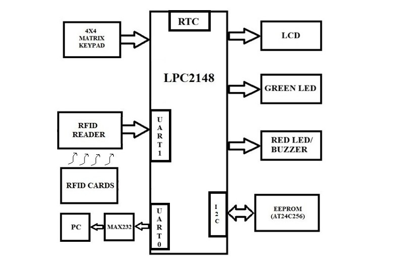

# SECUREBALLOT: RFID-Based Secure Electronic Voting System

## 📌 Overview

**SECUREBALLOT** is an embedded systems project that implements an RFID-based electronic voting prototype using the ARM7 LPC2148 microcontroller and Embedded C. It combines RFID card identification, password verification, voting-time control, and EEPROM data storage to manage a voting session.

The system provides separate interfaces for the election officer and registered voters through an LCD and keypad. It also maintains voter voting status, records vote counts, and supports event logging through serial communication.

## 🎯 Objectives

- Identify registered voters using RFID cards.
- Authenticate voters using individual passwords.
- Prevent duplicate voting by maintaining voter status.
- Allow the election officer to start and stop voting.
- Configure voting start and end times using the RTC.
- Store voter information, passwords, and vote counts in EEPROM.
- Display voting menus and system messages on the LCD.
- Provide result viewing and voting reset functions.

## 🛠️ Technologies Used

| Component | Description |
|---|---|
| Microcontroller | ARM7 LPC2148 |
| Programming Language | Embedded C |
| IDE | Keil µVision |
| RFID Interface | UART1 |
| Serial Monitoring | UART0 |
| Data Communication | I2C |
| Non-volatile Storage | I2C EEPROM |
| Time Management | On-chip RTC |
| Display | LCD |
| Input | Matrix Keypad |

## 🔧 Hardware Requirements

- ARM7 LPC2148 development board
- RFID reader and registered RFID cards
- LCD display
- Matrix keypad
- I2C EEPROM
- Power supply
- Connecting wires and supporting components

## ✨ Key Features

### 1. RFID Card Authentication
The system receives RFID card data through UART1 using interrupt-driven communication and identifies registered officer and voter cards.

### 2. Password-Based Authentication
Voters must enter their password before proceeding with voting. The election officer has a separate password-protected interface.

### 3. Voting Session Management
The officer can start or stop voting and configure the voting period.

### 4. Duplicate Voting Prevention
The system checks whether a voter has already voted and maintains the corresponding status in EEPROM.

### 5. RTC-Based Time Validation
The system uses the Real-Time Clock to check whether voting is enabled and whether the current time falls within the configured voting period.

### 6. EEPROM Data Storage
The system stores voting configuration, voter passwords, voter status, and party vote counts in EEPROM.

### 7. Vote Counting and Result Display
The system increments the selected party's vote count, saves the updated count, and provides a function to view the results.

### 8. Password Management
Voters can change their passwords by verifying their existing password before entering a new one.

### 9. Event Logging
The logger module supports recording system events, RFID card information, and date/time information through serial communication.

## 🔄 System Workflow

1. **Initialization:** Initialize the LCD, keypad, UART, I2C, RTC, and required system settings.
2. **RFID Scanning:** Scan a registered RFID card.
3. **Card Identification:** Identify the card as an officer card, voter card, or invalid card.
4. **Authentication:** Verify the applicable password.
5. **Voting Validation:** Check the voting enable status, configured time, and previous voting status.
6. **Vote Casting:** Allow an eligible voter to select an available party option.
7. **Data Update:** Increment the selected party's vote count and mark the voter as having voted.
8. **Result Management:** Allow the officer to view results or reset voting data using the officer menu.

## 👨‍💼 Election Officer Functions

- Set voting start and end times.
- Start voting.
- Stop voting.
- View election results.
- Reset voting information.
- Edit RTC settings.

## 📂 Project File Structure

```text
SECUREBALLOT/
│
├── secure_ballot_system_main.c
├── voter.c
├── officer.c
├── authenticate.c
├── uart1int.c
├── uart0.c
├── rtc.c
├── i2c.c
├── i2c_eeprom.c
├── lcd.c
├── kpm.c
├── logger.c
├── delay.c
├── functiondeclaration.h
├── component_defines.h
│
├── major_block.jpg
├── output_image1.jpeg
├── output_image2.jpeg
├── Screenshot 2026-10-10 112323.png
│
└── README.md
```

## 🧩 Module Description

| File | Purpose |
|---|---|
| `secure_ballot_system_main.c` | Main program, initialization, RFID processing, and system flow |
| `authenticate.c` | RFID card identification |
| `voter.c` | Voter menu, password verification, voting, and vote counting |
| `officer.c` | Election officer operations and voting control |
| `uart1int.c` | UART1 initialization and interrupt-driven RFID reception |
| `uart0.c` | UART0 serial communication |
| `rtc.c` | RTC initialization and date/time management |
| `i2c.c` | I2C communication functions |
| `i2c_eeprom.c` | EEPROM read and write operations |
| `lcd.c` | LCD display control |
| `kpm.c` | Keypad interfacing |
| `logger.c` | Event and date/time logging |
| `delay.c` | Delay functions |
| `functiondeclaration.h` | Function declarations |
| `component_defines.h` | Hardware definitions, addresses, and configuration constants |

## 🚀 How to Run the Project

1. Download or clone the repository.
2. Open Keil µVision.
3. Create or open a project configured for the LPC2148.
4. Add the supplied C source files and header files to the project.
5. Configure the target device and required startup settings.
6. Compile the project and resolve any build errors.
7. Connect the hardware components according to the circuit diagram.
8. Program the compiled firmware onto the LPC2148 development board.
9. Test RFID recognition, password verification, voting-time restrictions, duplicate-voting prevention, vote counting, and officer operations.

**Note:** The actual pin connections, compiler configuration, and programming procedure depend on the hardware setup used for the project.

## 🖼️ Project Images

The repository includes the following visual resources:




## 🔮 Future Enhancements

- Add more advanced voter authentication methods.
- Improve protection of stored credentials and election data.
- Introduce detailed audit reports.
- Develop a graphical interface for election monitoring.
- Expand voter capacity and test reliability under larger workloads.

## 📚 Learning Outcomes

This project demonstrates practical experience with:

- Embedded C programming.
- ARM7 LPC2148 microcontroller peripherals.
- UART interrupt handling.
- I2C communication and EEPROM interfacing.
- RTC-based time management.
- LCD and keypad interfacing.
- Modular embedded software development.
- Data management and voting control logic.

## ⚠️ Disclaimer

This project is an educational embedded systems prototype. It has not been independently security-audited or certified for real-world public elections.

## 👨‍💻 Project Details

- **Project Name:** SECUREBALLOT: RFID-Based Secure Electronic Voting System
- **Domain:** Embedded Systems
- **Controller:** ARM7 LPC2148
- **Language:** Embedded C
- **Development Tool:** Keil µVision

---

⭐ If you find this project useful, feel free to explore the source code and learn more about embedded systems development.
